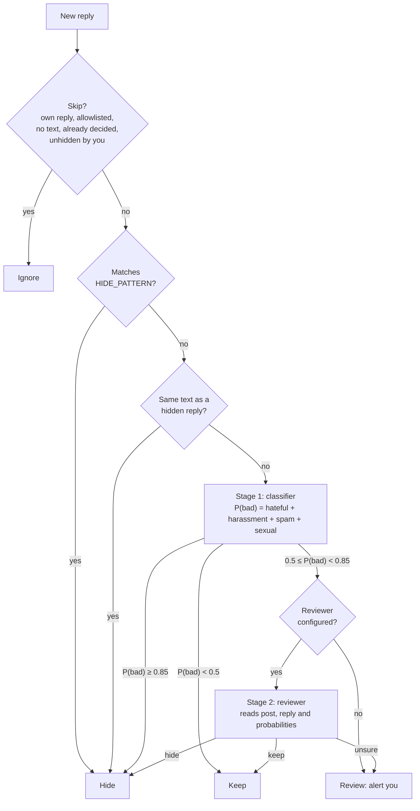

# socialbtw

Hides spam, hate and harassment in the replies to your
[Threads](https://www.threads.com) posts.

It polls your posts, rates each new reply with a model, and hides the bad ones
through the official Threads API. Every decision is logged as JSON and counted
in Prometheus metrics. Written in Rust: a 5 MB image using about 1-2 MiB of
memory.

Works with Indonesian, English and mixed replies. **Spam** includes product or
service promotion (even a friendly "use X, only Rp 99.000"), links and domains
(also obfuscated like "(dot)"), referral codes, and judi online or slot ads.

**Limits of the Threads API:** it can only hide replies, not delete them, block
users or like replies. Only top-level replies can be hidden (this hides their
nested replies too). Image-only replies and replies under your reposts are
skipped.

## How a reply is decided



- **Classifier** (stage 1, every new reply): a decision model such as
  Cloudflare Clef or TypeSafe Jev (`CLASSIFIER=systemone`), or any
  OpenAI-compatible chat model (`CLASSIFIER=chat`).
- **Reviewer** (stage 2, only unclear replies): any OpenAI-compatible chat
  model, optional.
- **Pattern** (no model call): a reply matching `HIDE_PATTERN`, a
  case-insensitive regex, is hidden as `spam` (`stage=pattern`). For example
  `gacor|slot\s*\d+|wa\.me/\d+|t\.me/`. Keep it to words that are never fine
  in a reply: a match is hidden without review.
- **Copypasta** (no model call): spam comes in waves of the same text. A reply
  whose text matches a hidden reply, ignoring case, spaces, punctuation and
  emoji, is hidden too (`stage=copypasta`). Texts under 20 letters and digits
  never match.
- Each reply is decided once. If you unhide a reply in Threads, it stays
  unhidden, its copies are classified again, and it is logged as `unhidden`
  so you can see what the app got wrong.
- **Repeat offenders:** Threads has no block API. When one author has
  `STRIKE_LIMIT` (3) hidden replies within `STRIKE_WINDOW` (30 days), each
  further hide logs `block_suggested` with their profile link, so you can
  block them by hand.
- With `DRY_RUN=true` (the default), hides are only logged as `would_hide`.
  Replies decided during a dry run are not revisited.

## How often posts are read

Every 5 minutes the app lists your own posts from the last `LOOKBACK_DAYS`.
Quiet posts are read less often, by the age of their last activity (the post
or its newest reply):

| Last activity | Replies read every |
|---|---|
| under 1 day | 5 min |
| 1 to 7 days | 1 h |
| 7 to 30 days | 6 h |

A new reply makes a post count as fresh again. Change the tiers with
`POST_CHECK_SCHEDULE` (default `1d:5m,7d:1h,30d:6h`).

**If you post a lot:** at most `MAX_POSTS_PER_POLL` (50) posts are read per
poll, most overdue first; the rest wait for the next poll. Lists are fetched
100 items per page.

**Rate limits** (HTTP 429, or Meta error codes 4, 17, 32, 613) pause polling
for 15 minutes, doubling while they continue, up to 6 hours. A hide that fails
is saved as `hide_pending` and retried on its own, without classifying the
reply again. If the reply is gone (another 4xx), it becomes `hide_failed`.

## Setup

**1. Meta app.** At <https://developers.facebook.com/apps>, create an app with
the **Access the Threads API** use case. Add the permissions `threads_basic`,
`threads_read_replies` and `threads_manage_replies`. Under App roles, add your
account as a **Threads Tester** and accept the invite in Threads (Settings >
Account > Website permissions). Development mode is enough; no app review.

**2. Token.** Either:
- **From the browser (recommended):** set `THREADS_APP_ID`,
  `THREADS_APP_SECRET`, `OAUTH_REDIRECT_URI` (an HTTPS URL that reaches
  `/oauth/callback`, also added to the app's Redirect Callback URLs) and
  `THREADS_USERNAME`. Open `/oauth/start` and approve. The redirect happens in
  your browser, so the app can stay private (LAN or VPN).
- **By hand:** get a long-lived token (60 days) and set `THREADS_ACCESS_TOKEN`.

Either way, the app refreshes the token every day, so it never expires while
the app runs.

**3. Classifier.** For example, Clef on Cloudflare (free tier: 10,000
Neurons/day), with a token that has **Workers AI: Read**:

```bash
CLASSIFIER_URL=https://api.cloudflare.com/client/v4/accounts/<account-id>/ai/run/@cf/cloudflare/clef
CLASSIFIER_TOKEN=<cloudflare token>
```

Or through [LiteLLM](https://docs.litellm.ai/docs/decisions) (v1.104.2+),
so one virtual key covers the classifier and the reviewer:

```bash
CLASSIFIER_URL=http://litellm:4000/v1/systemone   # model_name "clef" -> cloudflare/@cf/cloudflare/clef
CLASSIFIER_TOKEN=<virtual key>
LLM_BASE_URL=http://litellm:4000/v1               # optional reviewer
LLM_API_KEY=<virtual key>
LLM_MODEL=<small chat model>
```

Or a chat model as the classifier: `CLASSIFIER=chat`, `CLASSIFIER_URL` set to
an OpenAI-compatible base URL, `CLASSIFIER_MODEL=claude-haiku-4-5` (for
example). It is slower and costs more than a decision model; reasoning models
can take over a minute per reply.

**4. Run.**

```bash
docker run -d --name socialbtw -p 9090:9090 -v socialbtw:/data \
  -e THREADS_ACCESS_TOKEN=... -e CLASSIFIER_URL=... -e CLASSIFIER_TOKEN=... \
  ghcr.io/franzramadhan/socialbtw:main
```

Check the `would_hide` decisions for a few days, then set `DRY_RUN=false`.

## Configuration

| Env | Default | |
|---|---|---|
| **Threads** | | |
| `THREADS_ACCESS_TOKEN` | | Token, if not registered at `/oauth/start` |
| `THREADS_APP_ID`, `THREADS_APP_SECRET`, `OAUTH_REDIRECT_URI` | | All three enable `/oauth/start` and `/oauth/callback` |
| `THREADS_USERNAME` | | Reject tokens for any other account |
| **Decisions** | | |
| `CLASSIFIER` | `systemone` | `systemone` (Clef, Jev) or `chat` |
| `CLASSIFIER_URL` | required | `systemone`: full endpoint. `chat`: base URL like `http://litellm:4000/v1` |
| `CLASSIFIER_TOKEN` | | Bearer token |
| `CLASSIFIER_MODEL` | `clef` (systemone) | e.g. `clef`, `clef-flash`, `jev`, or a chat model; required for `chat` |
| `LLM_BASE_URL`, `LLM_API_KEY`, `LLM_MODEL` | | Reviewer. Without it, unclear replies go to `review` |
| `HIDE_THRESHOLD` | `0.85` | P(bad) that hides without review |
| `REVIEW_THRESHOLD` | `0.5` | P(bad) that goes to the reviewer |
| `HIDE_PATTERN` | | Case-insensitive regex that hides without the classifier |
| `EXTRA_RULES` | | Your own policy for the chat prompts, e.g. `Mild swearing between friends is fine.` |
| `DRY_RUN` | `true` | `false` to really hide |
| **Which posts** | | |
| `LOOKBACK_DAYS` | `3` | How far back to read your posts |
| `POLL_INTERVAL_SECONDS` | `300` | |
| `POST_CHECK_SCHEDULE` | `1d:5m,7d:1h,30d:6h` | See "How often posts are read" |
| `TOPICS` | | Only posts with one of these Threads topics (comma-separated) |
| `HASHTAGS` | | Only posts with one of these `#hashtags`. With `TOPICS`, either one matches |
| `ALLOWLIST` | | Usernames never touched |
| `STRIKE_LIMIT`, `STRIKE_WINDOW` | `3`, `30d` | Hidden replies by one author within the window that log `block_suggested`; `STRIKE_LIMIT=0` turns it off |
| **Notifications** | | |
| `NOTIFY_URL` | | Push `review` and `block_suggested`: an ntfy topic (`https://ntfy.sh/my-topic`) or `https://api.telegram.org/bot<token>/sendMessage?chat_id=<id>` |
| `NOTIFY_TOKEN` | | ntfy access token, for a protected topic |
| `MAX_POSTS_PER_POLL` | `50` | Posts whose replies are read per poll; 0 for no cap |
| `RATE_LIMIT_BACKOFF`, `RATE_LIMIT_MAX_BACKOFF` | `15m`, `6h` | First and longest pause after a rate limit |
| **Storage and runtime** | | |
| `DATABASE_URL` | | PostgreSQL (`postgres://...?sslmode=require`) instead of SQLite. One instance only |
| `DATABASE_CA_FILE` | | PEM CA for a private PostgreSQL certificate |
| `DB_PATH` | `/data/socialbtw.db` | SQLite file. It holds the token: keep it private |
| `METRICS_PORT` | `9090` | `/metrics` and `/oauth/*`. Expose only `/oauth/` |
| `HTTP_TIMEOUT_SECONDS` | `120` | Per outbound call |

## Observability

Each decision is a JSON log line (`msg=decision`) with the reply, `category`,
`bad_probability`, `action` (`hidden`, `would_hide`, `kept`, `review`,
`hide_pending`, `hide_failed`),
`stage` (`classifier`, `reviewer`, `pattern` or `copypasta`), `reason` and `permalink`.
`msg=unhidden` is a reply the app hid and you unhid, with its `bad_probability`.
`msg=block_suggested` names an author to block, with `strikes` and `profile`.

| Metric | |
|---|---|
| `threads_replies_total{category,action,stage}` | Decisions |
| `threads_bad_probability` | Histogram of P(bad), for tuning thresholds |
| `threads_post_checks_total{result}` | Posts read (`checked`), not due (`skipped`) or left for the next poll (`over_budget`) |
| `threads_unhidden_total{category}` | Hidden by the app, unhidden by you (false positives) |
| `threads_block_suggested_total` | Hides by authors over the strike limit |
| `threads_api_errors_total{endpoint}` | Failed calls |
| `threads_last_poll_success_timestamp_seconds` | Last good poll |
| `threads_token_expiry_timestamp_seconds` | Token expiry |
| `threads_rate_limited_until_timestamp_seconds` | End of the current rate-limit pause |

Useful alerts: `increase(threads_replies_total{action="review"}[15m]) > 0`
(needs you), `increase(threads_block_suggested_total[1h]) > 0` (someone to
block), `time() - threads_last_poll_success_timestamp_seconds > 1800`
(stuck), `threads_token_expiry_timestamp_seconds - time() < 7*86400` (refresh
failing), `threads_rate_limited_until_timestamp_seconds > time()` (paused). For the
reply text on your phone, set `NOTIFY_URL`. Notifications are best effort: a
failed one is logged and counted in `threads_api_errors_total{endpoint="notify"}`,
not retried. While the app is off, nothing is decided, so nothing is sent; the
catch-up poll sends what came in meanwhile.

## Development

```bash
cargo test   # unit tests; CI runs them on every pull request
TEST_DATABASE_URL=postgres://... DATABASE_CA_FILE=ca.crt cargo test postgres   # optional
TEST_CHAT_URL=http://litellm:4000/v1 TEST_CHAT_MODEL=... cargo test live_chat  # optional
```

| `src/` | |
|---|---|
| `main.rs` | wiring |
| `monitor.rs` | poll loop and per-reply decisions |
| `classifier.rs` | categories, `Classifier` trait, `systemone` and `chat`, thresholds |
| `reviewer.rs`, `llm.rs` | stage 2, chat client |
| `notify.rs` | ntfy and Telegram notifications |
| `threads.rs`, `oauth.rs` | Threads API, token registration |
| `server.rs`, `store.rs` | HTTP endpoints, SQLite or PostgreSQL |
| `metrics.rs`, `http.rs`, `util.rs` | metrics, outbound HTTP, helpers |

## License

MIT
