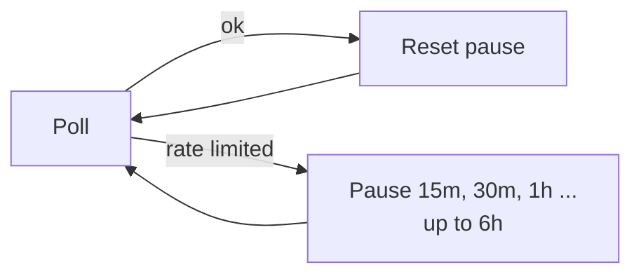

# 0001: Rate-limit handling and read budget

| Status | Date | PR | Release |
|---|---|---|---|
| implemented (written after the fact) | 2026-10-19 | #2 | v0.5.0 |

> Rate limits pause polling with a doubling backoff, failed hides are retried
> without paying for a second classification, and each poll reads at most 50
> posts.

## Problem

The Threads API rate limits read calls. Before this change:

- A rate-limited call only failed the poll. The next poll retried after the
  usual 5 minutes, without backing off.
- A failed hide dropped the decision, so the reply was classified (and paid
  for) again on every retry.
- Accounts that post a lot read every due post in every poll, in pages of 25.

## Proposal

**Detecting a rate limit:** HTTP 429, or one of these Meta error codes.

| Code | Meaning |
|---|---|
| 4 | App request limit |
| 17 | User request limit |
| 32 | Page request limit |
| 613 | Calls within one hour exceeded |

**Pausing:** a rate limit stops the poll and pauses polling. A good poll
resets the pause.

**Failed hides:** a reply whose hide fails is saved as `hide_pending` and
retried at the start of each poll, without classifying it again.

| Hide result | Action | Next |
|---|---|---|
| ok | `hidden` | done |
| rate limited | `hide_pending` | poll stops, retried after the pause |
| 4xx (reply gone) | `hide_failed` | done, logged as an error |
| other error | `hide_pending` | retried next poll |

**Read budget:** at most `MAX_POSTS_PER_POLL` posts are read per poll, most
overdue first. The rest wait for the next poll and count as `over_budget`.
Lists use 100 items per page instead of 25.

### Configuration

| Env | Default | |
|---|---|---|
| `RATE_LIMIT_BACKOFF` | `15m` | First pause |
| `RATE_LIMIT_MAX_BACKOFF` | `6h` | Longest pause |
| `MAX_POSTS_PER_POLL` | `50` | `0` for no cap |

### Logs and metrics

| | |
|---|---|
| `threads_rate_limited_until_timestamp_seconds` | End of the current pause |
| `threads_post_checks_total{result="over_budget"}` | Posts left for the next poll |
| `action=hide_pending`, `action=hide_failed` | Hide waiting for a retry, or given up |

## Alternatives

| Option | Why not |
|---|---|
| Read Meta's usage headers and slow down before a limit | Not documented for Threads, so the app reacts to errors instead |
| A fixed retry delay | Either too slow to recover or too aggressive under a long limit; doubling covers both |

## Testing and rollout

- **Tests:** rate-limit detection, backoff, due-post ordering with the cap, a
  rate-limited hide that ends `hidden` after one retry without a second
  classification, and a reply that is gone.
- **Rollout:** v0.5.0. The defaults need no config.
- **Off switch:** `MAX_POSTS_PER_POLL=0` removes the cap. The backoff has no
  switch; set both backoff values to `5m` to keep the normal interval.
