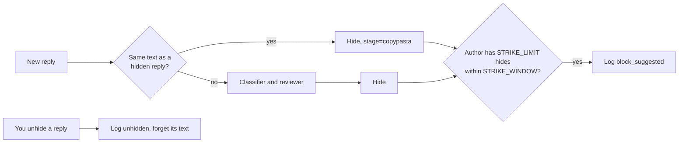

# 0002: Repeat offenders, copypasta and unhides

| Status | Date | PR | Release |
|---|---|---|---|
| implemented | 2026-10-20 | #4 | v0.6.0 |

> Copies of a hidden reply are hidden without a model call, repeat offenders
> are flagged for you to block, and replies you unhide are counted as false
> positives.

## Problem

- **Spam waves:** judi online and promo spam arrive as many replies with the
  same text. Each copy is sent to the classifier and paid for.
- **No blocking:** the Threads API cannot block users, so the same author
  keeps coming back, and nothing tells you who to block by hand.
- **No feedback:** when you unhide a reply the app hid, the app only skips it.
  Nothing counts these mistakes, so `HIDE_THRESHOLD` is tuned blind.

## Proposal

**Copypasta.** Text is reduced to lowercase letters and digits (no spaces,
punctuation or emoji). A hidden reply stores this key in the `kv` table; a
later reply with the same key is hidden without the classifier, with
`stage=copypasta`. Keys under 20 characters are ignored, so short replies
like "mantap kak" never match. `DRY_RUN` still applies.

**Strikes.** After each hide (`hidden`, `would_hide` or `hide_pending`), the
app counts that author's hides within `STRIKE_WINDOW`. At `STRIKE_LIMIT` or
more, it logs `block_suggested` with the count and a profile link. Each
further hide logs again, until you block the author.

**Unhides.** A reply with `hide_status=UNHUSHED` that the app had `hidden`
becomes `unhidden` (once). It no longer counts as a strike, and its copypasta
key is cleared, so copies are classified again.

No schema change: strikes are counted from the `replies` table, copypasta
keys live in `kv`.

### Configuration

| Env | Default | |
|---|---|---|
| `STRIKE_LIMIT` | `3` | Hides by one author that trigger `block_suggested`; `0` turns it off |
| `STRIKE_WINDOW` | `30d` | How far back hides count |

### Logs and metrics

| | |
|---|---|
| `msg=decision`, `stage=copypasta` | Hidden as a copy; `reason` names the original reply |
| `msg=block_suggested` | `username`, `strikes`, `profile`, `permalink` |
| `msg=unhidden` | Reply, `category` and `bad_probability` of a false positive |
| `threads_block_suggested_total` | Hides by authors over the limit |
| `threads_unhidden_total{category}` | False positives by category |

## Alternatives

| Option | Why not |
|---|---|
| Block through the API | Threads has no block endpoint |
| Block with browser automation | Breaks Meta's terms and risks your own account |
| Fuzzy matching (simhash) for copypasta | More code; exact match after normalizing catches the waves seen so far. Add it if spam starts varying words |
| Feed unhidden replies into the prompt as examples | Useful later; first see how many there are |
| A switch to turn copypasta off | Only repeats a decision already made; unhiding the original stops it |

## Testing and rollout

- **Tests:** normalizing text into keys; a copy hidden without a second
  classifier call; a third strike logging `block_suggested`; an unhide
  counted once and its copies classified again; strike and unhide queries on
  SQLite and PostgreSQL.
- **Rollout:** v0.6.0. Defaults need no config. Existing hidden replies have
  no copypasta key, so matching starts with new hides.
- **Off switch:** `STRIKE_LIMIT=0` for strikes. Copypasta and unhide tracking
  have no switch.
