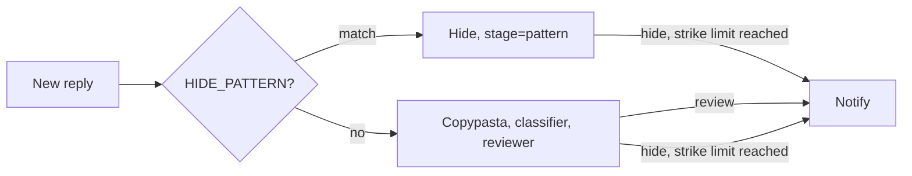

# 0003: Notifications and hide pattern

| Status | Date | PR | Release |
|---|---|---|---|
| implemented | 2026-10-20 | #5 | v0.7.0 |

> Replies that need you (`review`, `block_suggested`) are pushed to ntfy or
> Telegram, and a regex you choose hides obvious spam without a model call.

## Problem

- **Nothing reaches you:** `review` and `block_suggested` are only log lines.
  You need a log alert to see them. The homelab is off at night, so the
  morning catch-up can produce several at once.
- **Model calls for obvious spam:** judi online replies ("slot gacor",
  `wa.me/62...`) all go to the classifier, although a keyword says enough.
  Copypasta (RFC 0002) catches exact repeats only.

## Proposal

**Hide pattern.** `HIDE_PATTERN` is one regex, matched case-insensitively
against the reply text, before the copypasta lookup and the classifier. A
match is hidden as `category=spam`, `stage=pattern`, with the matched text in
`reason`. `DRY_RUN`, the allowlist and strikes all apply. An invalid regex
stops the app at startup. It uses `regex-lite` (small, no Unicode tables), so
`\d` and `\w` are ASCII only.

**Notifications.** `NOTIFY_URL` picks the target by its shape:

| Target | `NOTIFY_URL` | Sent as |
|---|---|---|
| ntfy | `https://ntfy.sh/my-topic` (or a self-hosted server) | JSON to the server root: `topic`, `title`, `message`, `click` |
| Telegram | `https://api.telegram.org/bot<token>/sendMessage?chat_id=<id>` | JSON: `chat_id`, `text` |

| Event | Title | Message | Click |
|---|---|---|---|
| `review` | Review reply by @user | Reply text, category, P(bad), reviewer reason | Reply permalink |
| `block_suggested` | Block @user? | Strike count, window, latest reply | Profile |

Best effort: a failed send is logged and counted in
`threads_api_errors_total{endpoint="notify"}`, never retried, and never
stops the poll. Notifications are also sent in a dry run, so you can judge
them before going live.

### Configuration

| Env | Default | |
|---|---|---|
| `HIDE_PATTERN` | | Case-insensitive regex; empty turns it off |
| `NOTIFY_URL` | | ntfy topic or Telegram sendMessage URL; empty turns it off |
| `NOTIFY_TOKEN` | | ntfy access token for a protected topic |

### Logs and metrics

| | |
|---|---|
| `msg=decision`, `stage=pattern` | Hidden by `HIDE_PATTERN`; `reason` has the match |
| `msg=notify failed` | A notification that did not go through |
| `threads_api_errors_total{endpoint="notify"}` | Failed notifications |

## Alternatives

| Option | Why not |
|---|---|
| A list of patterns (`HIDE_PATTERNS`, comma-separated) | Regexes contain commas (`\d{1,3}`); one regex with `\|` is enough |
| Substring matching, no new crate | Misses `slot\s*\d+` and obfuscated links, the main use |
| The full `regex` crate | Larger binary for Unicode support this needs rarely |
| Webhooks or a generic JSON webhook target | ntfy and Telegram cover phone pushes; a generic one needs a template language |
| Retry failed notifications | A missed push is not lost data: the log line and metrics stay |

## Testing and rollout

- **Tests:** ntfy and Telegram request shapes, invalid URLs; a pattern match
  hidden without the classifier; a `review` decision sending one notification.
- **Rollout:** v0.7.0. Both features are off until their env is set.
- **Off switch:** unset `HIDE_PATTERN` or `NOTIFY_URL`.
